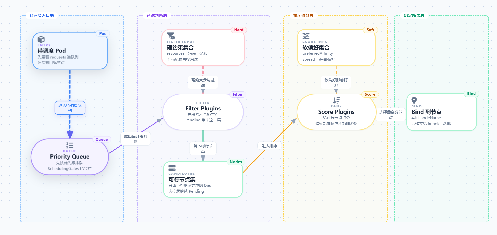

# 一、调度

`kube-scheduler`的主要作用就是根据特定的调度算法和调度策略将 Pod 调度到合适的 Node 节点上去，是一个独立的二进制程序，启动之后会一直监听 API，Server，获取到`PodSpec.NodeName` 为空的 Pod，对每个 Pod 都会创建一个 binding。

## 调度机制

### 1.Taint/Toleration

污点（Taint）配置在 Node 上，容忍（Toleration）配置在 Pod 上。

污点用于让节点排斥不符合条件的 Pod；容忍则允许 Pod 忽略与其匹配的污点，从而参与该节点的调度。需要注意的是，容忍并不保证 Pod 一定会被调度到该节点。

可以通过以下命令为节点添加污点。污点由 `key`、`value` 和 `effect` 组成，一个节点也可以配置多个污点。

```bash
kubectl taint nodes node1 key1=value1:NoSchedule
```

调度器会根据 `key`、`effect` 和 `operator` 匹配 Pod 的容忍；当 `operator` 为 `Equal` 时，`value` 也必须匹配。为 Pod 配置了相应容忍后，它才能通过该污点的检查。以控制平面节点常见的 `node-role.kubernetes.io/control-plane:NoSchedule` 污点为例，可为 Pod 添加如下容忍：

```yaml
tolerations:
- key: node-role.kubernetes.io/control-plane
  effect: NoSchedule
  operator: Exists
```

常用的 `effect` 有三种，按排斥强度由高到低排列如下：

`NoExecute`：拒绝不匹配的 Pod 调度到该节点，并驱逐节点上已有的不匹配 Pod。若 Pod 的容忍中设置了 `tolerationSeconds`，驱逐会在对应时长后发生。

`NoSchedule`：拒绝不匹配的 Pod 调度到该节点，但不影响节点上已运行的 Pod。

`PreferNoSchedule`：调度器会尽量避免将不匹配的 Pod 调度到该节点；当没有更合适的节点时，Pod 仍可能被调度到这里。

此外，Kubernetes 会使用内置污点标记异常或压力状态下的节点，例如 `node.kubernetes.io/memory-pressure` 表示节点存在内存压力。不同内置污点的 `effect` 不尽相同，具体含义可参考 [官方文档](https://kubernetes.io/zh-cn/docs/concepts/scheduling-eviction/taint-and-toleration/)。

> 提示：DaemonSet 控制器会自动为其 Pod 添加部分内置污点的容忍，以便节点级组件能够在异常节点上继续运行；这并不意味着 DaemonSet 会忽略所有污点。

### 2.Affinity

`NodeAffinity`、`PodAffinity` 和 `PodAntiAffinity` 统称为亲和性规则，用于基于节点标签或 Pod 标签约束调度位置。

#### NodeAffinity

通过 Pod 的 `spec.affinity.nodeAffinity` 字段配置。它分为硬性约束 `requiredDuringSchedulingIgnoredDuringExecution` 和软性约束 `preferredDuringSchedulingIgnoredDuringExecution`。

如下配置要求 Pod 必须被调度到带有 `disktype=ssd` 标签的节点；如果不存在符合条件的节点，Pod 会一直处于 `Pending` 状态。

> 提示：多个 `nodeSelectorTerms` 之间是“或”关系；同一个 `matchExpressions` 中的多个表达式是“与”关系。

```yaml
apiVersion: v1
kind: Pod
metadata:
  name: nginx
spec:
  affinity:
    nodeAffinity:
      requiredDuringSchedulingIgnoredDuringExecution:
        nodeSelectorTerms:
        - matchExpressions:
          - key: disktype
            operator: In
            values:
            - ssd
  containers:
  - name: nginx
    image: nginx
    imagePullPolicy: IfNotPresent
```

软性约束会让 Pod 优先调度到带有 `disktype=ssd` 标签的节点；若没有符合条件的节点，仍可调度到其他节点。`weight` 用于设置该偏好的评分权重，并参与候选节点的评分。

```yaml
apiVersion: v1
kind: Pod
metadata:
  name: nginx
spec:
  affinity:
    nodeAffinity:
      preferredDuringSchedulingIgnoredDuringExecution:
      - weight: 1
        preference:
          matchExpressions:
          - key: disktype
            operator: In
            values:
            - ssd
  containers:
  - name: nginx
    image: nginx
    imagePullPolicy: IfNotPresent
```

`In`、`NotIn`、`Exists`、`DoesNotExist`、`Gt` 和 `Lt` 等操作符的具体语义，可参考 [Kubernetes 官方文档](https://kubernetes.io/zh-cn/docs/concepts/scheduling-eviction/assign-pod-node/#operators)。

#### Pod Affinity

Pod 间亲和性用于让 Pod 靠近满足标签选择器的其他 Pod。调度器会依据 `topologyKey` 划分拓扑域；例如，指定可用区标签后，可以让 Pod 与目标 Pod 尽量位于同一可用区。

与节点亲和性相同，Pod 间亲和性也支持硬性约束和软性约束：

* `requiredDuringSchedulingIgnoredDuringExecution`
* `preferredDuringSchedulingIgnoredDuringExecution`

当需要让两个频繁通信的 Pod 位于同一拓扑域、以降低网络延迟时，可以使用 Pod 间亲和性。

#### Pod AntiAffinity

Pod 间反亲和性与 Pod 间亲和性的作用相反：它使 Pod 尽量或必须避开带有指定标签的其他 Pod 所在的拓扑域。通过 `podAntiAffinity` 字段配置。

```yaml
apiVersion: v1
kind: Pod
metadata:
  name: with-pod-affinity
spec:
  affinity:
    podAffinity:
      requiredDuringSchedulingIgnoredDuringExecution:
      - labelSelector:
          matchExpressions:
          - key: security
            operator: In
            values:
            - S1
        topologyKey: topology.kubernetes.io/zone
    podAntiAffinity:
      preferredDuringSchedulingIgnoredDuringExecution:
      - weight: 100
        podAffinityTerm:
          labelSelector:
            matchExpressions:
            - key: security
              operator: In
              values:
              - S2
          topologyKey: topology.kubernetes.io/zone
  containers:
  - name: with-pod-affinity
    image: registry.k8s.io/pause:2.0
```

tip：大集群中这类规则（PodAffinity / PodAntiAffinity）可能带来较高调度开销，尤其是跨大量节点或复杂标签选择器时，要谨慎使用。

### 3.TopologySpreadConstraints

拓扑分布约束用于让 Pod 尽量均匀地分散到不同的拓扑域中，例如节点、可用区、区域或由自定义标签定义的域。

Pod API 提供 `spec.topologySpreadConstraints` 字段，基本配置如下：

```yaml
topologySpreadConstraints:
    - maxSkew: <integer>
      minDomains: <integer> # 可选
      topologyKey: <string>
      whenUnsatisfiable: <string>
      labelSelector: <object>
      matchLabelKeys: <list> # 可选
      nodeAffinityPolicy: [Honor|Ignore] # 可选
      nodeTaintsPolicy: [Honor|Ignore] # 可选
```

`maxSkew` 定义任一拓扑域中匹配 Pod 的数量与全局最小值之间允许的最大差值。

`whenUnsatisfiable: DoNotSchedule` 表示：若调度后会超过 `maxSkew`，Pod 不会被调度，并会保持 `Pending` 状态。

`whenUnsatisfiable: ScheduleAnyway` 表示：即使无法满足 `maxSkew`，调度器仍会选择能最大程度降低偏差的拓扑域，使 Pod 分布尽量均衡。

`topologyKey` 是节点标签的键，用于标识节点所属的拓扑域。

### 4.Priority

优先级定义 Pod 的调度顺序，并决定其是否可以抢占低优先级 Pod 的资源。

使用 API 对象 `PriorityClass` 定义优先级；Pod 通过在模板配置中设置 `priorityClassName` 字段引用它。`value` 越大，优先级越高。

```yaml
apiVersion: scheduling.k8s.io/v1
kind: PriorityClass
metadata:
  name: high-priority
value: 1000000
globalDefault: false
description: "This priority class should be used for XYZ service pods only."
```

**抢占：**当高优先级 Pod 因资源不足而找不到满足所有调度条件的节点时，调度器会尝试在合适的节点上驱逐一个或多个低优先级 Pod，以便为它腾出资源。被驱逐的 Pod 终止后，高优先级 Pod 才会被调度到该节点。高优先级 Pod 不一定能成功抢占，PDB、亲和性、资源碎片等都可能使抢占后仍无法落点

当 `PriorityClass` 的 `preemptionPolicy` 显式设置为 `Never` 时，该优先级类中的 Pod 不会抢占其他 Pod。

## 调度链

下面以简化流程说明 kube-scheduler 的主要工作：

1. **进入调度队列**：新 Pod 创建后，若 `spec.nodeName` 为空，kube-scheduler 会尝试为它选择节点。
2. **Filter 过滤**：淘汰资源不足、污点不匹配、亲和性不满足、存储或端口冲突的节点。
3. **Score 打分**：根据资源利用率、亲和性偏好、拓扑分布等策略为候选节点评分并排序。
4. **Bind 绑定**：调度器通过 Binding API 将 Pod 绑定到目标节点；随后由该节点上的 kubelet 负责启动 Pod。



# 二、自定义调度器

随着集群规模和业务类型不断增加，仅依赖默认调度策略往往难以覆盖所有场景。例如，AI 训练任务可能需要优先使用特定 GPU 节点，批处理任务可能需要集中或分散部署，部分业务还会有独立的资源偏好与准入规则。

推荐的方式是基于 **Scheduling Framework（调度框架）** 编写插件：保留 kube-scheduler 的整体调度流程，只在需要的位置注入自己的决策逻辑。

## Scheduling Framework

从 Kubernetes 1.15 起，调度器逐步演进为可插拔架构。调度核心负责维护调度流水线；资源适配、污点与容忍、亲和性、拓扑分布和节点打分等具体策略，则通过插件挂载在不同的扩展点上。

每个扩展点对应调度流程中的一个阶段。部分插件会直接影响节点选择结果，部分插件则负责准备状态、执行绑定或发送通知。多个插件按既定顺序组合后，便构成完整的调度链。

| **扩展点**         | **时机**  | **典型用途**                                      |
| ------------------------ | --------------- | ------------------------------------------------------- |
| **QueueSort**      | 调度队列排序    | 决定先调度谁（如优先级），同时只能一个                  |
| **PreFilter**      | 过滤前          | Pod 级预处理、前置校验，出错直接终止                    |
| **Filter**         | 逐节点过滤      | **硬约束** ：资源够不够、taint/toleration、亲和性 |
| **PostFilter**     | 无节点可过时报  | 实现上文的抢占逻辑（Preemption）                        |
| **PreScore**       | 打分前          | 生成共享状态                                            |
| **Score**          | 候选节点打分    | **软偏好** ：分散/紧凑、镜像本地、拓扑            |
| **NormalizeScore** | 打分后          | 分数归一化                                              |
| **Reserve**        | 选定节点后      | 内存里占住资源，防并发重复计算                          |
| **Permit**         | 绑定前闸门      | 批准 / 拒绝 /**延迟** （Gang Scheduling 关键）    |
| **PreBind**        | 绑定前          | 挂盘、网络准备                                          |
| **Bind**           | 真正写 nodeName | 可覆盖默认绑定                                          |
| **PostBind**       | 绑定后          | 通知、指标、清理                                        |

基于该框架，我们只需实现所需扩展点的接口，并在启动 kube-scheduler 时注册插件。调度器运行到对应阶段时，就会调用插件中的实现。

## 简单实现示例

下面实现一个最小的 NodeLabel 插件，它只使用两个扩展点：

- Filter：仅允许带有 scheduler.example.com/enabled=true 标签的节点进入候选集。
- Score：在候选节点中，优先选择带有 scheduler.example.com/preferred=true 标签的节点。

在插件目录下创建文件并实现 FilterPlugin 与 ScorePlugin 接口：

```go
package nodelabel

import (
	"context"

	v1 "k8s.io/api/core/v1"
	"k8s.io/apimachinery/pkg/runtime"
	framework "k8s.io/kube-scheduler/framework"
)

const (
	Name = "NodeLabel"

	RequiredLabel = "scheduler.example.com/enabled"
	PreferredLabel = "scheduler.example.com/preferred"
)

var _ framework.FilterPlugin = &Plugin{}
var _ framework.ScorePlugin = &Plugin{}


type Plugin struct{}

func New(_ context.Context, _ runtime.Object, _ framework.Handle) (framework.Plugin, error) {
	return &Plugin{}, nil
}

func (p *Plugin) Name() string {
	return Name
}

// Filter 只保留明确启用该调度器的节点。
func (p *Plugin) Filter(_ context.Context, _ framework.CycleState, _ *v1.Pod, nodeInfo framework.NodeInfo) *framework.Status {
	node := nodeInfo.Node()
	if node == nil {
		return framework.NewStatus(framework.Error, "node object is missing")
	}
	if node.Labels[RequiredLabel] != "true" {
		return framework.NewStatus(framework.Unschedulable, "node is not enabled for self-scheduler")
	}
	return nil
}

// Score 优先选择标记为 preferred 的节点。
func (p *Plugin) Score(_ context.Context, _ framework.CycleState, _ *v1.Pod, nodeInfo framework.NodeInfo) (int64, *framework.Status) {
	node := nodeInfo.Node()
	if node == nil {
		return 0, framework.NewStatus(framework.Error, "node object is missing")
	}
	if node.Labels[PreferredLabel] == "true" {
		return framework.MaxNodeScore, nil
	}
	return 0, nil
}

func (p *Plugin) ScoreExtensions() framework.ScoreExtensions {
	return nil
}
```

其中，Filter 用于表达硬约束：未启用标签的节点会被直接淘汰；Score 用于表达软偏好：节点仍可被选择，但带有 preferred 标签的节点会获得更高分。

然后在 main.go 中注册插件：

```go
command := app.NewSchedulerCommand(
		app.WithPlugin(nodelabel.Name, nodelabel.New),
	)
```

注册仅表示二进制中包含该插件；还需要在调度器配置的 Profile 中启用它。

```yaml
apiVersion: kubescheduler.config.k8s.io/v1
kind: KubeSchedulerConfiguration
profiles:
  - schedulerName: self-scheduler
    plugins:
      filter:
        enabled:
          - name: NodeLabel
      score:
        enabled:
          - name: NodeLabel
            weight: 10
```

需要使用该调度器的 Pod 再指定相同的 schedulerName：

```yaml
spec:
  schedulerName: self-scheduler
```

具体完整代码见 [selfSchedulingTest](https://github.com/ysss-ee/selfSchedulingTest)。

完成插件实现后，需要将它编译进 kube-scheduler 二进制并打包为镜像，再以 Deployment 方式部署就好啦。默认调度器仍可继续处理普通 Pod；只有指定 self-scheduler 的 Pod 才会进入本示例的自定义调度流程。

> 提示：调度器仍需要通过 RBAC 获取 Pod、Node 等资源并创建 Binding。RBAC 决定“调度器是否有权限执行操作”，插件则决定“节点如何被选择”，两者职责不同。

### 运行方式与验证

需要注意：Scheduling Framework 插件必须在编译 kube-scheduler 二进制时一并编译进去。调度器配置文件的职责是启用、禁用或调整已注册插件的顺序与权重；它不能把一个新的 Go 插件动态安装到官方 kube-scheduler 镜像中。

NodeLabel 并不会接管全部调度逻辑。它只是额外参与 Filter 和 Score 阶段；默认调度器中的资源检查、污点与容忍、节点亲和性等插件仍会继续生效。因此，一个节点只有同时满足默认约束和 NodeLabel 的自定义规则，才可能被选中。

下面是在本地集群中复现该示例的一组最小步骤：

```bash
# 1. 构建包含插件的自定义调度器镜像
cd selfSchedulingTest
docker build -t example/self-scheduler:v1.36.1 .

# 2. 为目标节点添加插件读取的标签
kubectl label node <node-name> scheduler.example.com/enabled=true
kubectl label node <node-name> scheduler.example.com/preferred=true

# 3. 部署自定义调度器及其配置
kubectl apply -f manifests/scheduler.yaml

# 4. 创建由 self-scheduler 处理的演示 Pod
kubectl apply -f manifests/demo-pod.yaml

# 5. 验证 Pod 的实际调度结果与调度器日志
kubectl get pod self-scheduler-demo -o wide
kubectl logs -n self-scheduler-system deployment/self-scheduler
```

如果集群使用 kind、远程 Kubernetes 集群或私有镜像仓库，还需要先将镜像加载或推送到该集群可以访问的镜像仓库。

# 三、如何选择调度机制

日常场景下，优先使用 Kubernetes 已提供的调度能力；只有当这些能力无法表达业务规则时，再考虑开发调度框架插件。

| 需求                           | 优先选择                      | 典型场景                               |
| ------------------------------ | ----------------------------- | -------------------------------------- |
| 排斥某类工作负载               | Taint / Toleration            | 专用节点、控制平面节点、异常节点       |
| 约束或偏好节点位置             | NodeAffinity                  | GPU、SSD、特定机型或地域节点           |
| 让多个 Pod 靠近或分散          | PodAffinity / PodAntiAffinity | 低延迟服务、主备隔离                   |
| 提升多副本的可用性             | TopologySpreadConstraints     | 跨节点、跨可用区均匀部署               |
| 在资源紧张时确定先后顺序       | PriorityClass                 | 核心服务优先于离线任务                 |
| 表达默认机制无法覆盖的复杂规则 | Scheduling Framework 插件     | 自定义硬件选择、业务配额、批量或组调度 |

# 四scheduler的一些实现细节

实际生产环境的集群大多为大集群，对于一个有几千节点的集群我们难道要对所有节点一个个遍历筛选吗？考虑到这个问题，k8s有一个percentageOfNodesToScore机制。

`numFeasibleNodesToFind` 方法根据当前集群的节点数计算出参与预选的节点数量,

1. 按节点列表（round-robin 方式）逐个跑 Filter
2. 每找到一个「可行节点（feasible node）」就计数
3. **一旦可行节点数量达到阈值，立即停止继续 Filter，直接进入 Score 阶段**

如果对更多细节或者具体的k8s scheduler实现感兴趣可以查阅k8s相关[源码](https://github.com/kubernetes/kubernetes)。这里也推荐一个分析k8s调度器源码的文章[kubernetes_scheduler_code](https://github.com/rfyiamcool/notes/blob/main/kubernetes_scheduler_code.md)
